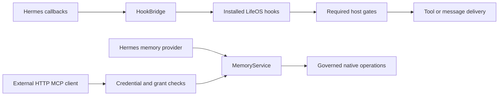

# Codebase map

Read this page when starting work in the repository. For installation, use the [user guide](installation-workflow.md). For development conventions and commands, use [CONTRIBUTING.md](../CONTRIBUTING.md).

## Read in this order

1. Read the [root README](../README.md) for product scope and the supported combination.
2. Check [TODO](../TODO.md) and the [current release record](verification/2026-10-16-release-0.7.3/README.md).
3. Find the relevant source and test family in the tables below.
4. Read the task's active guide and nearby implementation tests.
5. Open a dated record only when its decision, regression, or fixture is relevant.

The repository has two installable plugins. `lifeos_hook_bridge/` integrates runtime behavior and governed memory. `optional/lifeos_release_manager/` prepares and applies complete packages. A complete release includes both, patched upstream programs, dependencies, and the host dashboard.

## Repository ownership

| Path | What it owns |
| --- | --- |
| [`lifeos_hook_bridge/`](../lifeos_hook_bridge/) | Hook dispatch, native adapters, memory policy, dashboard API, public bridge commands |
| [`optional/lifeos_release_manager/`](../optional/lifeos_release_manager/) | Release catalog, certificate/archive checks, program plans, detached installation/recovery, memory workflows, software removal |
| [`optional/lifeos-memory-sharing/`](../optional/lifeos-memory-sharing/README.md) | Optional SSH enrollment and stdio sharing; HTTP is included in the bridge |
| [`patches/`](../patches/) | Development copies of ordered upstream patches |
| [`lifeos_hook_bridge/patches/`](../lifeos_hook_bridge/patches/) | Distributed patch copies used by the installer |
| [`scripts/`](../scripts/) | Source/package preparation, paired-effect controls, installed probes, and older transaction tools |
| [`tests/`](../tests/) | Python unittest suites, Node component tests, and synthetic fixtures |
| [`development/`](../development/README.md) | Opt-in private trace recorder, not the general developer setup |
| [`docs/verification/`](verification/README.md) | Dated test and release evidence, including package-input operators |
| [`docs/agents/`](agents/README.md) | Independent review reports, raw findings, and fixture snapshots |
| [`notes/`](../notes/README.md) | Engineering decisions and measured investigation notes |

The two active patch lists have the same base revisions, names, and bytes. [`test_patch_bundle.py`](../tests/test_patch_bundle.py) checks that. The [source preparation guide](clean-install.md) explains which tool reads which copy.

Historical source snapshots inside evidence directories are not active implementations. Start searches in the owning source directory. Use `git ls-files` when local caches and untracked artifacts would obscure the result.

## Runtime request flow

The diagram shows ownership boundaries. Each action has additional authority, source, and publication checks. A returned hook directive alone does not prove that Hermes enforced it.

| Task | Start here | Neighboring implementation |
| --- | --- | --- |
| Plugin registration and lifecycle | [`__init__.py`](../lifeos_hook_bridge/__init__.py) | [`plugin.yaml`](../lifeos_hook_bridge/plugin.yaml), [`bridge.py`](../lifeos_hook_bridge/bridge.py), [`hook_state.py`](../lifeos_hook_bridge/hook_state.py) |
| Tool, command, and remote-hook behavior | [`bridge.py`](../lifeos_hook_bridge/bridge.py) | [`bash_permissions.py`](../lifeos_hook_bridge/bash_permissions.py), [`file_permissions.py`](../lifeos_hook_bridge/file_permissions.py), [`remote_hooks.py`](../lifeos_hook_bridge/remote_hooks.py), [`mcp_permissions.py`](../lifeos_hook_bridge/mcp_permissions.py) |
| Provider/model/effort routing | [`model_tiers.py`](../lifeos_hook_bridge/model_tiers.py) | [`cli.py`](../lifeos_hook_bridge/cli.py), [`bin/claude_direct.py`](../lifeos_hook_bridge/bin/claude_direct.py), native model patches |
| Private Discord audience and delivery | [`discord_audience.py`](../lifeos_hook_bridge/discord_audience.py) | [`discord_delivery.py`](../lifeos_hook_bridge/discord_delivery.py), host lifecycle/delivery patches |
| Governed memory tool contract | [`memory_service.py`](../lifeos_hook_bridge/memory_service.py) | [`memory_policy.py`](../lifeos_hook_bridge/memory_policy.py), [`memory_access.py`](../lifeos_hook_bridge/memory_access.py) |
| Hermes memory context and prompt admission | [`memory_provider.py`](../lifeos_hook_bridge/memory_provider.py) | [`memory_runtime.py`](../lifeos_hook_bridge/memory_runtime.py), [`memory_context.py`](../lifeos_hook_bridge/memory_context.py), [`memory_lineage.py`](../lifeos_hook_bridge/memory_lineage.py) |
| Native memory calls and publication | [`memory_canonical.py`](../lifeos_hook_bridge/memory_canonical.py) | [`memory_native.ts`](../lifeos_hook_bridge/memory_native.ts), [`memory_publication.ts`](../lifeos_hook_bridge/memory_publication.ts), [`memory_transaction.py`](../lifeos_hook_bridge/memory_transaction.py) |
| External MCP transports | [`memory_remote.py`](../lifeos_hook_bridge/memory_remote.py) | [`memory_oauth.py`](../lifeos_hook_bridge/memory_oauth.py), [`memory_mcp.py`](../lifeos_hook_bridge/memory_mcp.py) |
| Native dashboard HTTP relay | [`memory_http.py`](../lifeos_hook_bridge/memory_http.py) | Owner-authorized native route relay, distinct from the external MCP listener |
| Ownership, import, export, and return | [`ownership_setup.py`](../lifeos_hook_bridge/ownership_setup.py) | [`memory_import.py`](../lifeos_hook_bridge/memory_import.py), [`memory_export.py`](../lifeos_hook_bridge/memory_export.py), [`memory_return.py`](../lifeos_hook_bridge/memory_return.py), manager [`memory_workflow.py`](../optional/lifeos_release_manager/memory_workflow.py) |
| Selected home and store recovery | [`lifeos_installation.py`](../lifeos_hook_bridge/lifeos_installation.py) | [`installation_selection.py`](../lifeos_hook_bridge/installation_selection.py), [`profile_backup.py`](../lifeos_hook_bridge/profile_backup.py), [`profile_backup_recovery.py`](../lifeos_hook_bridge/profile_backup_recovery.py) |
| Patched or reduced hook registration per Hermes process | [`registration.py`](../lifeos_hook_bridge/registration.py) | [`release_version.py`](../lifeos_hook_bridge/release_version.py) reports the registration and host drift through `hermes lifeos-version` |

Memory feature modules use `memory_<domain>.py` names, for example Atlas, TELOS, Conduit, Content, freshness, and proposals. Locate the feature module, then follow its calls into the shared admission and transaction layers. Do not treat a feature's raw native cache as an authorized read path.

## Dashboard sources

| Plugin | API | Editable assets | Manifest |
| --- | --- | --- | --- |
| Bridge | [`plugin_api.py`](../lifeos_hook_bridge/dashboard/plugin_api.py) | [`index.js`](../lifeos_hook_bridge/dashboard/dist/index.js), [`style.css`](../lifeos_hook_bridge/dashboard/dist/style.css) | [`manifest.json`](../lifeos_hook_bridge/dashboard/manifest.json) |
| Releases | [`plugin_api.py`](../optional/lifeos_release_manager/dashboard/plugin_api.py) | [`index.js`](../optional/lifeos_release_manager/dashboard/dist/index.js), [`style.css`](../optional/lifeos_release_manager/dashboard/dist/style.css) | [`manifest.json`](../optional/lifeos_release_manager/dashboard/manifest.json) |

The tracked `dist` files are the editable plugin assets. There is no plugin-local npm build or separate JSX source. The host supplies React, the SDK, theme variables, routing, and manifest asset loading. Keep endpoints and authorization behavior separate from presentation changes. Component tests cover SDK request shapes; installed acceptance verifies actual loading and browser behavior.

## Complete release flow

Read [`optional/lifeos_release_manager/__init__.py`](../optional/lifeos_release_manager/__init__.py) for command/skill registration and [`cli.py`](../optional/lifeos_release_manager/cli.py) for public actions.

| Stage | Main modules |
| --- | --- |
| Public catalog and immutable package checks | `release_catalog.py`, `release_payload.py` |
| Preparation and program plan | `release_preparation.py`, `release_plan.py`, `release_programs.py`, `release_stage.py` |
| Initial native layout and account checks | `release_initialization.py`, `release_accounts.py`, `release_services.py` |
| Detached operation, service drain, apply, recovery, rollback | `release_operation.py`, `release_worker.py`, `release_baseline.py` |
| Ownership, provider return, complete software removal | `memory_workflow.py`, `memory_workflow_worker.py`, `removal_*.py` |

An in-place release patches the owner's existing Hermes checkout instead of publishing a managed runtime. The [in-place installation design](in-place-installation-design.md) explains the stages. These modules implement it:

| Stage | Main modules |
| --- | --- |
| Read-only host check and the qualified manifest | `host_compatibility.py`, `host-compatibility.json`, `host_capabilities.py` |
| Host record, retained originals, and staged patched files | `host_record.py`, `host_patches.py` |
| Configuration values that LifeOS changes, and their restoration | `host_configuration.py` |
| Integration archive checks and preparation | `integration_package.py`, `inplace_preparation.py`, `dependency_plan.py` |
| Services and processes that use the Hermes checkout | `inplace_services.py`, `consumer_scan.py` |
| Host plan, review, apply, recovery, and rollback | `inplace_plan.py`, `inplace_worker.py` |
| Removal that restores the original Hermes files | `inplace_removal.py`, `stock_hermes.py` |

These module names refer to the [release-manager directory](../optional/lifeos_release_manager/). Operations live in the selected profile's private `.lifeos-releases` workspace. Their requests, plans, grants, maps, and journals are transaction inputs, not editable configuration. A queued worker or created archive does not establish an applied release.

[`scripts/build_host_compatibility.py`](../scripts/build_host_compatibility.py) writes the compatibility manifest from an exact stock Hermes archive. [`scripts/build_integration_release.py`](../scripts/build_integration_release.py) builds the reproducible in-place integration archive. [`scripts/local_release_server.py`](../scripts/local_release_server.py) serves a local build to the real catalog download path during qualification. [CONTRIBUTING](../CONTRIBUTING.md#release-changes) gives their commands.

The managed-runtime builder in [`scripts/build_managed_release.py`](../scripts/build_managed_release.py) selects committed package inputs explicitly. Some files under `docs/deployment/daily-text/` and the dated morning-delivery operator are executable package inputs. Do not bulk-move or delete `docs/` as if it contained prose only.

## Tests and verification

| Changed area | Test starting points |
| --- | --- |
| Bridge translation and hooks | [`test_bridge.py`](../tests/test_bridge.py), `test_core_*`, `test_native_*`, paired controls in `scripts/` |
| Models and provider routing | [`test_model_tiers.py`](../tests/test_model_tiers.py), inference and child-routing tests |
| Memory grants, context, and runtime | [`test_memory_policy.py`](../tests/test_memory_policy.py), [`test_memory_runtime.py`](../tests/test_memory_runtime.py), [`test_memory_service.py`](../tests/test_memory_service.py) |
| External memory connections | [`test_memory_remote.py`](../tests/test_memory_remote.py), [`test_memory_remote_host.py`](../tests/test_memory_remote_host.py), remote dashboard/UI tests |
| Release preparation and service binding | [`test_release_preparation.py`](../tests/test_release_preparation.py), [`test_release_services.py`](../tests/test_release_services.py), other `test_release_*` |
| In-place host check, manifest, and capabilities | [`test_host_compatibility.py`](../tests/test_host_compatibility.py), [`test_host_compatibility_manifest.py`](../tests/test_host_compatibility_manifest.py), [`test_host_capabilities.py`](../tests/test_host_capabilities.py) |
| In-place host record, patches, and configuration | [`test_host_record.py`](../tests/test_host_record.py), [`test_host_patches.py`](../tests/test_host_patches.py), [`test_host_configuration.py`](../tests/test_host_configuration.py) |
| In-place preparation, plan, services, and worker | [`test_inplace_preparation.py`](../tests/test_inplace_preparation.py), [`test_inplace_plan.py`](../tests/test_inplace_plan.py), [`test_inplace_services.py`](../tests/test_inplace_services.py), [`test_inplace_worker.py`](../tests/test_inplace_worker.py), [`test_consumer_scan.py`](../tests/test_consumer_scan.py), [`test_dependency_plan.py`](../tests/test_dependency_plan.py) |
| In-place integration archive and removal | [`test_integration_package.py`](../tests/test_integration_package.py), [`test_integration_release_build.py`](../tests/test_integration_release_build.py), [`test_inplace_removal.py`](../tests/test_inplace_removal.py), [`test_stock_hermes.py`](../tests/test_stock_hermes.py) |
| Bridge registration and host drift report | [`test_bridge_registration.py`](../tests/test_bridge_registration.py), [`test_release_version.py`](../tests/test_release_version.py) |
| Provider cycles and removal | [`test_memory_portability_lifecycle.py`](../tests/test_memory_portability_lifecycle.py), `test_removal_*`, portability and removal UI tests |
| Plugin presentation and request contracts | All `tests/*.cjs`, including [`test_setup_presentation.cjs`](../tests/test_setup_presentation.cjs); shared SDK fixture in [`tests/support/dashboard_sdk.cjs`](../tests/support/dashboard_sdk.cjs) |
| Private recorder | [`development/tests/test_capture.py`](../development/tests/test_capture.py) |

Some Python suites need prepared sources, native services, process visibility, or live test fixtures. Read their prerequisites. Keep component, native, installed, archive, and deployment results distinct. The [verification index](verification/README.md) explains how to interpret historical evidence.
