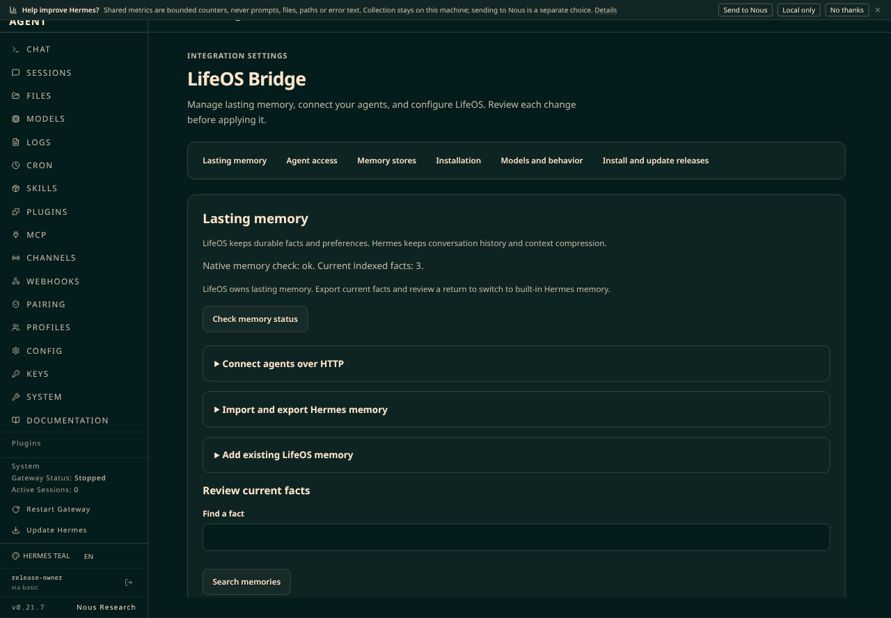
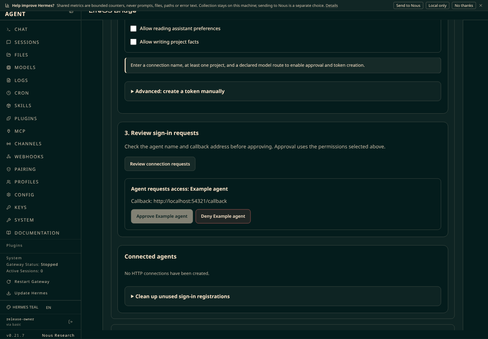
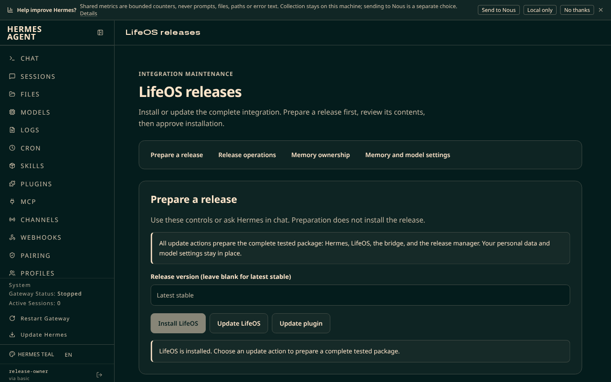

# Plugin setup interface verification

Date: 2026-10-16. Branch: `feature/plugin-setup-ui`.

The candidate gives the Bridge and release manager separate, scoped stylesheets through the supported Hermes plugin manifest field. It separates actions, field labels, routine setup, approval, and recovery. It preserves all existing program actions and backend policy.

## Measured cause

The running development dashboard has no LifeOS stylesheet. Enabled HTTP review, import review, reverse export review, and pending change review buttons have zero padding, zero border width, and a transparent background. Both manifests omit `css`. The Hermes loader supports that field. The current theme also omits several older color variables. The [safe baseline](baseline.json) and [engineering note](../../../notes/2026-10-16-plugin-setup-styles.md) record these observations.

## Verification

The primary agent repeats the delegated checks and inspects the final code. All 58 Bridge button call sites and all 11 manager button call sites remain present. Existing action labels remain present. The [agent report](../../agents/2026-10-16-plugin-setup-ui/plugin-setup-ui.md) gives the control inventory and initial failing regression results.

- All 42 component and Software Development Kit (SDK) contract tests pass. There are no skips. See [raw output](ui-tests.txt).
- Both authored JavaScript bundles pass `node --check`. The plugin has no separate transpilation step.
- Backend checks pass 64 tests and 61 subtests. Two environment-gated cases skip. See [raw output](backend-tests-prepared.txt).
- Initial backend checks lack the prepared Hermes import path, then the prepared LifeOS source fixture. Those runs fail before the relevant assertions. The final run supplies both existing fixtures. No test or assertion changes resolve these environment failures.
- `git diff --check` passes.

The backend command uses the existing frozen Python environment, the prepared Hermes source in `PYTHONPATH` and `LIFEOS_HERMES_SOURCE`, and the prepared native source in `LIFEOS_MEMORY_SOURCE`. The two skipped cases require additional installed fresh-store prerequisites. The candidate does not change backend code.

## Compiled dashboard inspection

The browser runs the actual compiled Hermes dashboard on `.252`. A temporary browser-only preview registers the candidate bundles and loads their candidate CSS from an allowlisted localhost asset server. It changes no installed program files. The preview rejects all non-GET SDK requests before they reach the server. The pending approval uses a synthetic browser response. Other initial page reads retain the existing metadata endpoints. The inspection does not search memory, review records, approve an actual connection, or change settings.

Both pages pass at 1440-pixel desktop width and 390-pixel phone width. The inspected states have no horizontal document overflow, no unstyled visible buttons, no visible buttons below 42 pixels in height, and no unlabelled form controls. The dark theme has a measured minimum text contrast of 8.50. A temporary matching light canvas and text palette has a measured minimum of 6.51. This palette check does not change the saved Hermes theme. Measurements exclude disabled controls and do not certify every custom theme or interaction state.

The synthetic pending approval starts disabled and links to the missing-field explanation. Entering a connection name and project enables it. Keyboard Tab produces a visible three-pixel focus outline. The permission inputs have no submitting form. Pressing Enter in a permission input makes zero non-GET requests. Actual approval and manual-token request contracts retain their component tests.

The [safe browser results](browser-results.json) contain measured values. The [measurement script](browser-measurements.js) returns geometry, style, and accessibility metadata without input values or memory content. These are component and compiled-host integration checks. They are not a new live installation or complete release qualification.

## Screenshots

The screenshots show the temporary candidate in the compiled development dashboard. The approval request is synthetic.

## Deployment and review limits

Neither server receives this candidate. Development `.252` and daily `.253` retain their installed qualified `0.7.1` packages. No version bump, publication, push, merge, or personal data migration forms part of this change. The normal package qualification and owner-reviewed update remain required before deployment.

The review should focus on disclosure placement, navigation, theme adaptation, and disabled-action explanations. The manual-token form boundary is the only intentional interaction adjustment. It prevents implicit token creation while the owner edits OAuth permissions. Endpoints, grants, approval rules, recovery rules, and model mappings retain their existing behavior.

The browser preview is removed by navigation or reload. The temporary asset server is stopped after inspection. No persistent server or dashboard configuration requires rollback.
