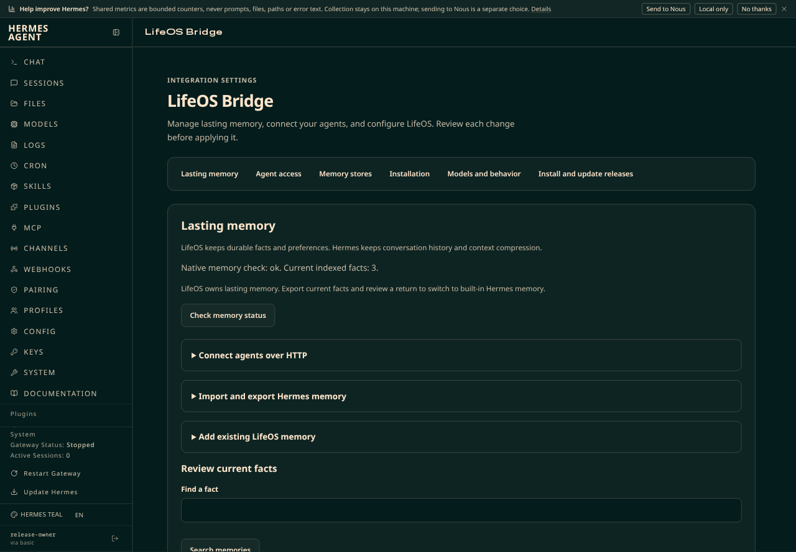

# LifeOS 0.7.2 release and deployment

The qualified program commit is `b257d29f81fa2b88d202da72914b778d4eda3bb5`. The archive is `0.7.2-b257d29f.tgz`, with SHA-256 `293cfa2c6593b597c327fb8ad11f458d3e374352552dfbe7f4dbba5cd7e67265`. Its size is 288,201,691 bytes.

The [independent PR36 review](../../agents/2026-10-16-pr36-review-r1/pr36-review-r1.md) reports CLEAR after one P3 evidence correction. The correction removes trailing whitespace from a saved failing test log. The reviewer verifies the correction and repeats all 42 interface tests. No product file changes after review. The [review equivalence receipt](review-equivalence.json) binds the reviewed program inputs to the exact archive.

Both plugins declare their own scoped stylesheet. The interface separates address setup, permissions, sign-in requests, and connected agents. The release page separates preparation, operation review, and advanced ownership controls. The [interface record](../2026-10-16-plugin-setup-ui/README.md) gives the screenshots and compiled-host inspection limits.

## Exact-package checks

All 42 interface component and Software Development Kit contract tests pass from the exact package. The 1,124-case archive integration run passes 1,122 cases on the workstation. One error and one failure refuse executable inspection of the unrelated non-dumpable `sshd-session` process. These are the same named cases recorded during 0.7.1 qualification.

All eight exact-archive process-boundary cases pass again under the isolated stock guest service account. The [boundary receipt](process-boundary.json) binds their test and program source hashes. No assertion or product policy changes. This is coverage across two environments, not one clean full run.

The integration gate verifies the archive file map before and after execution. All 21,170 archived regular files retain their bytes and required modes. Generated test bytecode and the existing bytecode guard metadata remain separate from archived files. No unhandled diagnostic occurs.

The [package comparison](package-verification.json) verifies that every backend program, both native program trees, the frozen Python closure, and stock Hermes match qualified 0.7.1. The changed program files are the two interface bundles, their stylesheets, their dashboard manifests, and plugin version declarations. Earlier installed update, rollback, HTTP, notification, and recovery gates remain inherited 0.7.1 evidence. No new automatic morning run or whole-guest restore is claimed.

The [initial qualification certificate](RELEASE-CERTIFICATE.json) records this scope and the exact archive identity. Publication must preserve that certificate and all prior release assets.

## Qualification guest

The owned guest starts from the retained synthetic stock baseline. Its messaging and Pulse services are masked before first boot. It receives the exact archived boundary-test sources and Bun 1.4.3. The tests use synthetic profiles and services. They do not use a production profile.

The [cleanup receipt](guest-cleanup.json) verifies graceful shutdown, removal, and unchanged power states for all original guests, including VM801. The initial cleanup check does not immediately observe stopped status in the aggregate inventory. The resumed operator verifies stopped status directly before removal and waits for inventory convergence. No host restart occurs.

## Publication and deployment

[PR36](https://github.com/0ut5ider/lifeos-hermes-plugin/pull/36) merges as `60c5fee32454be0b752e10ccccd1cd2b306418a8`. The [stable 0.7.2 release](https://github.com/0ut5ider/lifeos-hermes-plugin/releases/tag/v0.7.2) publishes the qualified archive, dashboard archive, and initial certificate. Publication preserves all 69 prior assets. The new [deployment asset](https://github.com/0ut5ider/lifeos-hermes-plugin/releases/download/v0.7.2/DEPLOYMENT-ACCEPTANCE.json) preserves those assets and all three initial 0.7.2 assets. No asset replacement occurs.

Development `.252` updates first through the actual Releases page controls. Daily `.253` then uses the same authenticated owner review and apply routes. Both prepare the published archive through the public catalog. The reviewed version, program commit, and package hash match the identity above. The updates retain the existing ownership mount and do not require a native remount.

| Installation | Applied operation | Verified version |
| --- | --- | --- |
| Development `.252` | `7ecc4302491d4d9e8a05b6e0056d03e0` | `0.7.2` |
| Daily `.253` | `9a17bb13744642c2bb9503643eb40d0b` | `0.7.2` |

Both installations pass selected-program verification, selected runtime checks, active gateway/dashboard/Pulse checks, fresh gateway heartbeat, and connected Discord state. Each installation returns the expected marker through its actual private FlashNext model without tools. Both pass the current private-audience and notification mirror-policy checks. The harness does not send a Discord message during this deployment.

The update preserves model choices, tier mapping, unrelated configuration, credential bytes, memory configuration, and the current owner mount journal. Daily retains all five HTTP connections, including four enabled connections. Its authenticated metadata and registered HTTP memory status and recall pass. The harness reads the existing project verification fact through its registered MCP connection. It does not read personal memory files or use dashboard memory-record APIs.

The daily Pulse configuration retains `0 7 * * *`. This release does not repeat an automatic morning observation or a whole-guest restore. Both guests retain the coherent `lifeos-072-preupdate-20261016` checkpoint. Writers stop before each checkpoint and resume afterward. The retained prior 0.7.1 operations remain rollback inputs.

## Installed interface acceptance

Both installations serve both plugin scripts and both plugin stylesheets with HTTP 200 and exact archive hashes. The host manifests declare version 0.7.2 and `dist/style.css`. All four responses use the correct content type and disable caching.

The installed development browser loads the stylesheets automatically after a normal reload. No preview stylesheet or script injection remains. At 1,440 and 390 pixels, the page has no horizontal overflow. All 22 visible buttons have padding, borders, and a minimum height. No visible control lacks its label. The daily authenticated manifests and public asset hashes match the same qualified package. This record does not claim an authenticated daily browser screenshot.

The [deployment acceptance receipt](deployment/DEPLOYMENT-ACCEPTANCE.json) binds the original safe operator receipts by SHA-256. Repository copies preserve the original receipt bytes. The HTTP before/after receipts remain in the operator workspace; the repository contains their reduced connection-metadata result. The [publication receipt](deployment/deployment-publication.json) records the new immutable asset. The deployment directory contains only safe receipts and the installed interface screenshot. Credentials, model narration, and personal records remain outside repository evidence.
